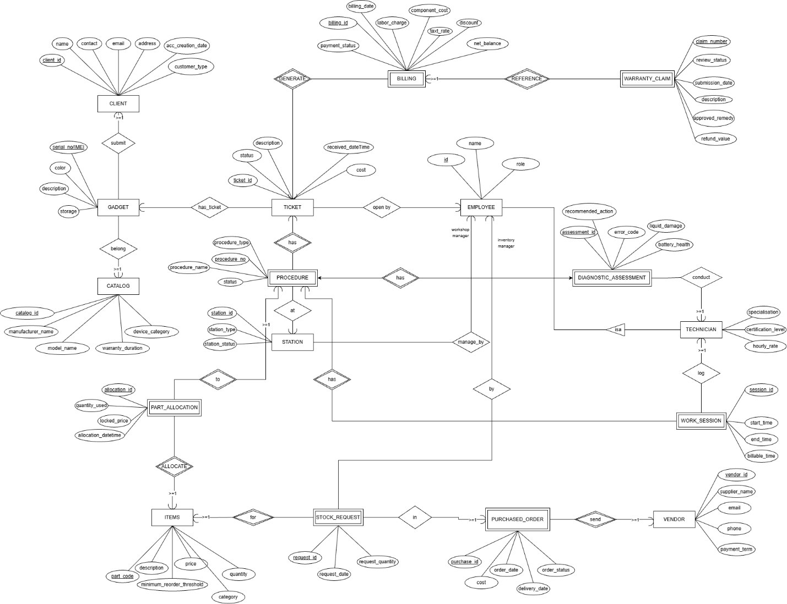

# TechPulse - Repair Service Database

NTU SC2207 Database Systems coursework modelling an electronics repair service in Microsoft SQL Server (T-SQL). The project covers customer and device intake, repair tickets, diagnostics, technician work sessions, parts inventory, purchasing, billing and warranty claims.

The implementation contains **19 relational tables** and **seven numbered query tasks**, with Query 5 split into corporate, retail and warranty scenarios. This repository presents content recovered from the Lab 5 submission and original local SQL files. The complete submission PDF and contribution forms are excluded.

## Database design



- [Relational schema, keys and normalization discussion](schema/relational-schema.md)
- [SQL table definitions](schema/create_tables.sql)
- [Original requested SC2207_LAB.drawio.png](diagrams/SC2207_LAB.drawio.png)
- [Later SC2207_LAB.drawio (2).png](diagrams/SC2207_LAB.drawio%20%282%29.png)

The schema uses primary and foreign keys, composite keys for dependent records, and CHECK and UNIQUE constraints. The report decomposes BILLING into BILLING_CALCULATION and BILLING_STATEMENT. The original diagram files represent different versions; the image above is the diagram embedded in the selected Lab 5 report.

## Repository layout

```text
diagrams/                  Original diagram files and the Lab 5 embedded ER image
schema/
  relational-schema.md    Submitted relation tables and normalization text
  create_tables.sql       Table definitions extracted from Lab 5
  originals/              Unchanged standalone setup SQL
data/sample_data.sql      INSERT statements extracted from Lab 5
queries/
  Q1_... through Q7_...    Nine SQL files extracted from Lab 5
  originals/              Unchanged standalone query SQL
docs/
  ASSUMPTIONS.md          Assumptions extracted from Lab 5
  SOURCE_NOTES.md         Version differences and limitations
  SOURCE_MANIFEST.json    Source filenames, hashes and extraction details
  VERIFICATION.md         Repository checks and execution limitations
```

## Queries

| Task | Purpose | SQL |
| --- | --- | --- |
| Q1 | Count completed procedures under 180 minutes by station and device category | [Procedure duration](queries/Q1_procedure_duration.sql) |
| Q2 | Aggregate labor and parts revenue for completed tickets | [Revenue](queries/Q2_revenue.sql) |
| Q3 | Find customers with claims associated with technician specialization mismatches | [Technician mismatch claims](queries/Q3_technician_mismatch_claims.sql) |
| Q4 | Summarize claims with qualifying liquid-damage diagnostics | [Diagnostic claims](queries/Q4_diagnostic_claims.sql) |
| Q5a | Demonstrate the corporate stock-allocation exception | [Corporate allocation](queries/Q5a_corporate_allocation.sql) |
| Q5b | Demonstrate blocking an ordinary retail allocation at low stock | [Retail allocation](queries/Q5b_retail_allocation.sql) |
| Q5c | Demonstrate the warranty stock-allocation exception | [Warranty allocation](queries/Q5c_warranty_allocation.sql) |
| Q6 | List customers with more than three work orders in one month for a device category | [Repeat visits](queries/Q6_repeat_visits.sql) |
| Q7 | Identify inventory at or below its reorder threshold | [Reorder stock](queries/Q7_reorder_stock.sql) |

## Run the extracted submission SQL

Use Microsoft SQL Server and a SQL client such as SQL Server Management Studio. Create an empty database for this project and select it in the query window.

1. Run [schema/create_tables.sql](schema/create_tables.sql) once.
2. Run [data/sample_data.sql](data/sample_data.sql) once.
3. Run the numbered files in [queries](queries) individually. Run each Q5 scenario as a complete block, from `BEGIN TRANSACTION` through `ROLLBACK`.

The extracted files do not create or select a database. Q5 temporarily inserts records and updates stock, then rolls back. The separate original setup script explicitly selects `TechPulse` and **drops and recreates its project tables**; it is preserved for reference and is an alternative to the two setup steps above, not an additional step.

The original query script's header refers to `techpulse_setup.sql`; the recovered setup file is named `techpulse_setup_updated.sql`. The original query script also differs from the submitted SQL in several tasks. Use the numbered extracted files when reviewing the submission.

## Scope and source fidelity

Read the [submitted assumptions](docs/ASSUMPTIONS.md) alongside the queries. For example, requested warranty payouts are inferred from recorded refunds only under the stated fully approved sample-claim assumption. The schema does not store requested payout independently.

Original SQL and diagram files are preserved unchanged. Extracted SQL retains the submitted logic; PDF-wrapped string literals were restored only when matched to the original standalone SQL. Documentation inconsistencies are recorded in [source notes](docs/SOURCE_NOTES.md), rather than silently revised.

SQL Server execution was not performed during repository assembly. The recovered report includes historical result screenshots, but this repository does not claim a fresh database test run. No new tables, queries, results or individual contribution claims have been invented.
